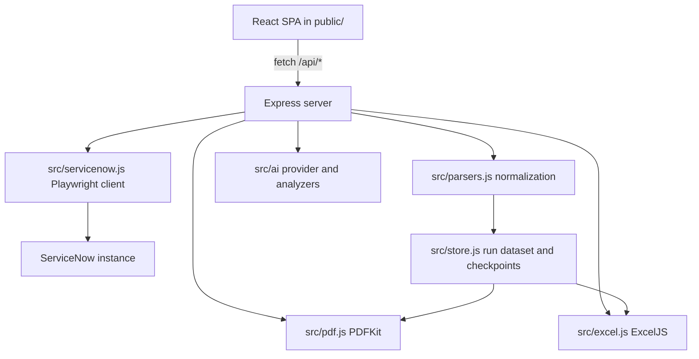

# ScrapeChangeTicket

<p align="center">
  <strong>ServiceNow Change Task scraping, review, and reporting</strong>
</p>

<p align="center">
  Node.js · Express · Playwright · React 19 · TypeScript · Tailwind CSS · PDFKit · ExcelJS
</p>

<p align="center">
  <a href="#overview">Overview</a> ·
  <a href="#installation">Installation</a> ·
  <a href="#configuration">Configuration</a> ·
  <a href="#running">Running</a> ·
  <a href="#api-reference">API Reference</a> ·
  <a href="#releases">Releases</a>
</p>

---

## Table of Contents

1. [Overview](#overview)
2. [Features](#features)
3. [Architecture](#architecture)
4. [Technology Stack](#technology-stack)
5. [Requirements](#requirements)
6. [Installation](#installation)
7. [Configuration](#configuration)
8. [Running](#running)
9. [Workflow](#workflow)
10. [Scraping Behavior](#scraping-behavior)
11. [Data Shape](#data-shape)
12. [Reporting](#reporting)
13. [AI Features](#ai-features)
14. [License Gate](#license-gate)
15. [API Reference](#api-reference)
16. [Project Structure](#project-structure)
17. [Testing](#testing)
18. [Troubleshooting](#troubleshooting)
19. [Releases](#releases)

---

## Overview

ScrapeChangeTicket reads Change Task records from a ServiceNow instance, normalizes them,
keeps them in a single run dataset, and turns that dataset into a patch release report
(PDF), a styled workbook (XLSX), or a JSON file. A React dashboard drives the whole flow:
session start, filter selection, scrape progress, ticket review, AI summary, and export.

The ServiceNow session is owned by Playwright. Credentials stay on the server and are never
sent to the browser.

---

## Features

**Scraping**
- Starts a Playwright session and waits for the authenticated ServiceNow list.
- Reads saved list filters, then selects one by name.
- Estimates the record count of the selected filter.
- Walks pagination, extracts list rows, then opens each ticket for detail and activity data.
- Skips tickets already processed in the run, so a resumed scrape does not duplicate records.
- Stores progress and checkpoints so a long run can be inspected or resumed.
- Supports pause, resume, and cancel while a run is active.

**Review**
- Ticket table with filters and a detail drawer.
- Per-ticket AI summary with risk level and category.
- Per-ticket AI risk analysis and duplicate detection against the current run.
- Evidence screenshot upload, attached to selected tickets and embedded in the PDF report.

**Reporting**
- PDF report per filter, with continuation pages for long Cause and Action Plan text.
- XLSX workbook with styled headers, freeze panes, autofilter, and a metadata sheet.
- JSON export of the full run, including metadata and per-ticket scrape status.

---

## Architecture



| Component | Responsibility |
|---|---|
| `src/server.js` | Express routes, scrape job orchestration, SPA fallback |
| `src/servicenow.js` | Login, filter discovery, pagination, detail and activity extraction |
| `src/parsers.js` | Row parsing, field normalization, metadata, export validation |
| `src/store.js` | Run object, upsert, checkpoint save and load |
| `src/pdf.js` / `src/excel.js` | Report generators |
| `src/license.js` | License key verification and device binding |
| `src/ai/*` | Provider dispatch, summary, risk analysis, duplicate detection |
| `frontend/` | React dashboard, built into `public/` |

---

## Technology Stack

| Layer | Technology |
|---|---|
| Runtime | Node.js v24 (ESM) |
| Backend | Express ^4.21.2 |
| Automation | playwright ^1.49.1 |
| PDF | pdfkit ^0.16.0 |
| Spreadsheet | exceljs ^4.4.0 |
| Frontend | React ^19.3.1 + TypeScript ~7.0.2 |
| Build | Vite ^8.3.5, output to `public/` |
| Styling | Tailwind CSS ^4.3.4, shadcn/ui pattern over Radix UI |
| Icons | lucide-react |
| Lint | ESLint (backend), oxlint (frontend) |
| Tests | Node.js test runner, Playwright Test |

---

## Requirements

- Windows 10 or 11. The launcher scripts, banner, and git hooks assume PowerShell.
- Node.js 20 or newer and npm.
- Chromium installed through Playwright.
- A ServiceNow account with access to Change Task.
- A license key from `zevn.web.id` (see [License Gate](#license-gate)).

---

## Installation

```powershell
git clone <REPOSITORY_URL>
cd ScrapeChangeTicket
npm install
npx playwright install chromium
```

`npm install` runs `postinstall`, which installs a `post-merge` git hook and prints the
project banner. The hook prints the banner again on `git pull`.

Build the dashboard once before starting the server for the first time:

```powershell
cd frontend
npm install
npm run build
cd ..
```

`npm run build` in `frontend/` writes the SPA to `public/`, which the Express server serves.

---

## Configuration

Configuration is read from `.env` in the project root by `src/config.js`. Copy the sample
file if it exists, then fill it in. Never commit `.env`; it is already in `.gitignore`.

### ServiceNow and server

| Variable | Default | Purpose |
|---|---|---|
| `SN_BASE_URL` | `https://pelindo.service-now.com` | Instance base URL |
| `SN_USERNAME` | empty | ServiceNow username |
| `SN_PASSWORD` | empty | ServiceNow password |
| `HEADLESS` | `false` | Run Chromium without a visible window |
| `PORT` | `3000` | HTTP port |
| `SN_MAX_RETRIES` | `2` | Retries per ticket operation |
| `SN_PAGE_SIZE` | `100` | Rows per list page |
| `SN_CHECKPOINT_EVERY` | `5` | Checkpoint interval |
| `SN_CONCURRENCY` | `1` | Ticket processing concurrency |
| `OUTPUT_DIR` | `output` | Generated reports, checkpoints, evidence |
| `PELINDO_LOGO_PATH` | `assets/pelindo-logo.png` | Logo placed in the PDF header |
| `NO_SERVER` | unset | Set to `true` to import the app without listening (tests) |
| `NODE_ENV` | unset | Set to `test` to silence the banner |

### License

| Variable | Default | Purpose |
|---|---|---|
| `ZEVN_LICENSE_API_URL` | `https://zevn.web.id/api/license/verify` | Verification endpoint |
| `ZEVN_LICENSE_FILE` | `.zevn-license.json` | Local license and device binding file |

### AI provider

`AI_PROVIDER` selects the provider: `groq` (default), `gemini`, `ollama`, `deepseek`, or
`openrouter`. An unknown name makes the AI endpoints return an error that lists the
supported providers.

| Provider | Key | Model override |
|---|---|---|
| `groq` | `GROQ_API_KEY` | `GROQ_MODEL` (default `qwen/qwen3.8-27b`) |
| `gemini` | `GEMINI_API_KEY` | `GEMINI_MODEL`, `GEMINI_BASE_URL` |
| `ollama` | none | `OLLAMA_MODEL`, `OLLAMA_BASE_URL` (default `http://localhost:11434`) |
| `deepseek` | `DEEPSEEK_API_KEY` | `DEEPSEEK_MODEL` |
| `openrouter` | `OPENROUTER_API_KEY` | `OPENROUTER_MODEL` |

All providers are called through the OpenAI-compatible chat completions shape.
AI calls use only ticket text from the current run; no credentials or session cookies are sent.

---

## Running

Development (server with `--watch`, banner on start):

```powershell
npm run dev
```

Production-style start:

```powershell
npm start
```

Frontend development with hot reload, proxying `/api` to the Node server:

```powershell
cd frontend
npm run dev
```

Open <http://localhost:3000> for the built app, or the Vite port for the dev frontend.

### npm scripts

| Script | Action |
|---|---|
| `npm start` | Run `src/server.js` |
| `npm run dev` | Banner plus `node --watch src/server.js` |
| `npm run banner` | Print the project banner |
| `npm test` | Unit, integration, and visual tests |
| `npm run test:unit` | Unit tests only |
| `npm run test:integration` | Integration tests only |
| `npm run test:visual` | Visual tests only |
| `npm run test:e2e` | Playwright end-to-end tests |
| `npm run lint` | ESLint over `src`, `tests`, `scripts` |
| `npm run live:smoke` | Live smoke check against a real instance |
| `npm run check:memory` | Verify `AGENTS.md` matches the files on disk |

Frontend scripts live in `frontend/package.json`: `dev`, `build`, `lint` (oxlint), `preview`.

---

## Workflow

1. Start the server and open the dashboard.
2. Start the browser session. Log in manually if the instance needs SSO or MFA.
3. Refresh filters, then pick the filter to scrape.
4. Read the estimate, then start scraping. Set a limit or leave it at 0 for all records.
5. Watch progress in the live log and the ticket table. Pause, resume, or cancel if needed.
6. Review tickets, run AI summary, risk, or duplicate checks where useful.
7. Upload evidence for tickets that need screenshots.
8. Export PDF, Excel, or JSON.

---

## Scraping Behavior

- The list lives in the ServiceNow iframe (`#gsft_main`); selectors are scoped to that frame.
- Filters come from the list filter menu, with menu actions and placeholders removed.
- Pagination reads the current page, extracts rows, then clicks the visible enabled Next control.
  It stops when the page signature repeats, when there is no next control, or at the page cap.
- A ticket that already exists in the run is updated, not appended.
- A failed ticket is recorded with `scrape_status: "failed"` and its error, and the run continues.
- `nipp_nrk` is filled from the ServiceNow `user_name`.
- The report PIC is read from the ticket description (`PIC: NAME` or `PIC Request: NAME`),
  falling back to the assigned user.
- Checkpoints are written during the run, so an interrupted scrape keeps its progress.

---

## Data Shape

A run is one JSON object, written to `output/<filter>-checkpoint.json` and exported as
`output/<filter>-result.json`.

```json
{
  "metadata": {
    "source": "ServiceNow",
    "filter_name": "CTASK OKTOBER",
    "scraped_at": "2026-11-01T04:00:00.000Z",
    "total_found": 272,
    "processed": 10,
    "success": 10,
    "failed": 0
  },
  "tickets": []
}
```

| Field | Content |
|---|---|
| `data_tabel` | The row as read from the list table |
| `detail_tiket` | Fields from the ticket form |
| `activities` | Activity history entries |
| `activities_status` | `ok` or `error` |
| `scrape_status` | `success` or `failed` |
| `errors` | Validation notes and extraction errors |
| `validation_status` | `valid`, `warning`, or `invalid` |

The parser keeps display values, so a reference field shows the label rather than the `sys_id`.

---

## Reporting

**PDF** (`src/pdf.js`)
- A4 portrait, header with logo, one table per ticket.
- Long Cause and Action Plan content continues onto following pages with page numbers.
- Evidence screenshots are embedded for tickets that have an uploaded image.
- Result column can be overridden per export with `resultDefault`
  (`Success`, `Warning`, `Error`, `Other`), applied to tickets without a stored result.

**Excel** (`src/excel.js`)
- One row per successful ticket, styled header, freeze panes, autofilter.
- Metadata worksheet with filter name, period, and counters.

**JSON**
- `GET /api/export/json` returns the full run, unfiltered.

Exports are blocked while a scrape is running and when there is no successful ticket, so the
report never covers a partial dataset.

---

## AI Features

All four features live in `src/ai/` and share `provider.js`.

| Module | Used by | Output |
|---|---|---|
| `summary.js` | `GET /api/tickets/:number/summary`, `GET /api/requests/:number/summary` | `summary`, `riskLevel`, `category` |
| `risk.js` | `POST /api/ai/analyze-risk` | Risk level with mitigation suggestions |
| `duplicate.js` | `POST /api/ai/detect-duplicates` | Matching tickets with similarity reason |
| `analysis.js` | Combined multi-ticket pass | Cross-ticket findings |

Summaries are cached in memory per ticket number and cleared on restart. If the provider
fails or returns malformed JSON, the summary falls back to `riskLevel: "medium"` and
`category: "Other"` instead of failing the request.

AI output is indicative. It is not a substitute for a change manager's review.

---

## License Gate

`src/license.js` verifies the license against `ZEVN_LICENSE_API_URL` and binds it to the
machine. The result is cached in `.zevn-license.json`.

The following route prefixes require an active license:
`/api/scrape`, `/api/ai`, `/api/session`, `/api/login`, `/api/filters`, `/api/estimate`,
`/api/requests`, `/api/tickets`.

`GET /api/license/status` reports the current state, `POST /api/license/activate` takes a
key, and `POST /api/license/deactivate` clears the local binding.
---

## API Reference

All routes are defined in `src/server.js`. JSON bodies are sent as `application/json`.

| Method | Path | Purpose |
|---|---|---|
| GET | `/api/license/status` | License and device binding status |
| POST | `/api/license/activate` | Activate a key |
| POST | `/api/license/deactivate` | Clear the local activation |
| GET | `/api/state` | Public app state: job, filters, estimate, counters |
| POST | `/api/session/start` | Launch the Playwright session |
| POST | `/api/login` | Log in; body `{ "manual": true }` for a visible manual login |
| POST | `/api/filters/refresh` | Read filters from ServiceNow |
| GET | `/api/filters` | Cached filter list and selected filter |
| POST | `/api/filters/select` | Select a filter by name; body `{ "name": "..." }` |
| GET | `/api/estimate` | Record estimate for the selected filter |
| POST | `/api/scrape` | Start a run; returns `409` if one is already active |
| POST | `/api/scrape/:action` | `pause`, `resume`, or `cancel` |
| GET | `/api/results` | Current run object |
| GET | `/api/export/json` | Download the run as JSON |
| POST | `/api/upload-evidence` | Body `{ "dataUrl": "...", "ticketNumbers": [] }` |
| POST | `/api/export/pdf` | Generate and download the PDF |
| GET/POST | `/api/export/pdf-preview` | Same report, served inline |
| GET | `/api/export/excel` | Download the XLSX |
| GET | `/api/requests` | Change Request list from the live instance |
| GET | `/api/requests/all` | Paged Change Request list |
| GET | `/api/requests/:number/detail` | Detail plus activities for one request |
| GET | `/api/requests/:number/summary` | AI summary for one request |
| GET | `/api/tickets/:number/summary` | AI summary for a ticket in the current run |
| POST | `/api/ai/analyze-risk` | Body `{ description, assignedTo, changeRequest, category }` |
| POST | `/api/ai/detect-duplicates` | Body `{ targetTicket, historicalTickets? }` |
| GET | `*` | SPA fallback to `public/index.html` |

Quick check:

```powershell
Invoke-RestMethod http://localhost:3000/api/state
```

---

## Project Structure

```text
ScrapeChangeTicket/
├── src/
│   ├── server.js          # Express routes and scrape job
│   ├── config.js          # .env loading and defaults
│   ├── servicenow.js      # Playwright client
│   ├── parsers.js         # Normalization and validation
│   ├── store.js           # Run, upsert, checkpoint
│   ├── pdf.js             # PDF report
│   ├── excel.js           # Excel report
│   ├── license.js         # License verification
│   ├── logger.js          # Leveled terminal logging
│   ├── utils.js           # Dates, sanitizers, atomic writes
│   └── ai/
│       ├── provider.js    # OpenAI-compatible provider dispatch
│       ├── summary.js
│       ├── risk.js
│       ├── analysis.js
│       └── duplicate.js
├── frontend/
│   ├── src/
│   │   ├── App.tsx
│   │   ├── main.tsx
│   │   ├── index.css
│   │   ├── components/    # shadcn/ui components, sidebar, topbar, cards
│   │   ├── hooks/         # app state, history, scraping timer
│   │   ├── lib/           # api types, fetch wrapper, formatters
│   │   └── views/         # dashboard, scrape, tickets, history, reports, settings
│   ├── index.html
│   └── vite.config.ts     # Build output to ../public
├── public/                # Built SPA served by Express
├── scripts/
│   ├── banner.js
│   ├── setup-hooks.js
│   └── check-memory-sync.js
├── tests/
│   └── unit/ integration/ visual/ e2e/ live/
├── assets/                # Logo used in the PDF header
├── output/                # Reports, checkpoints, evidence (gitignored)
├── CHANGELOG.md
└── README.md
```

---

## Testing

```powershell
npm test                  # unit + integration + visual
npm run test:unit
npm run test:integration
npm run test:visual
npm run test:e2e          # Playwright, browsers via npx playwright install
npm run lint
```

Frontend lint:

```powershell
cd frontend
npm run lint
```

`npm run live:smoke` talks to a real instance and needs a working `.env`.

---

## Troubleshooting

| Symptom | Likely cause |
|---|---|
| Login step never completes | SSO or MFA pending; use `POST /api/login` with `manual: true` |
| Empty filter list | List controls not opened, or the filter menu markup changed |
| Estimate shows 0 | Filter context mismatch; reselect the filter |
| Pagination stops early | Next control hidden or disabled; check the page signature log |
| `Tidak ada hasil` on export | No run yet, or no ticket finished with `success` |
| `409` on export | A scrape is still running; wait or cancel it |
| PDF missing logo | `PELINDO_LOGO_PATH` points at a missing file |
| AI endpoints return a provider error | `AI_PROVIDER` name unknown or its API key missing |
| License rejected | Device binding changed; deactivate then activate again |

Run `npm start` in a visible terminal to read the structured log output while reproducing an
issue. Avoid `force: true` in Playwright selectors as a first fix; check the frame and the
actual DOM state instead.

---

## Releases

Release history and version notes live in [CHANGELOG.md](CHANGELOG.md). Tags follow
`vMAJOR.MINOR.PATCH`.

```powershell
git tag -l
git tag -a v1.0.0 -m "v1.0.0"
```
