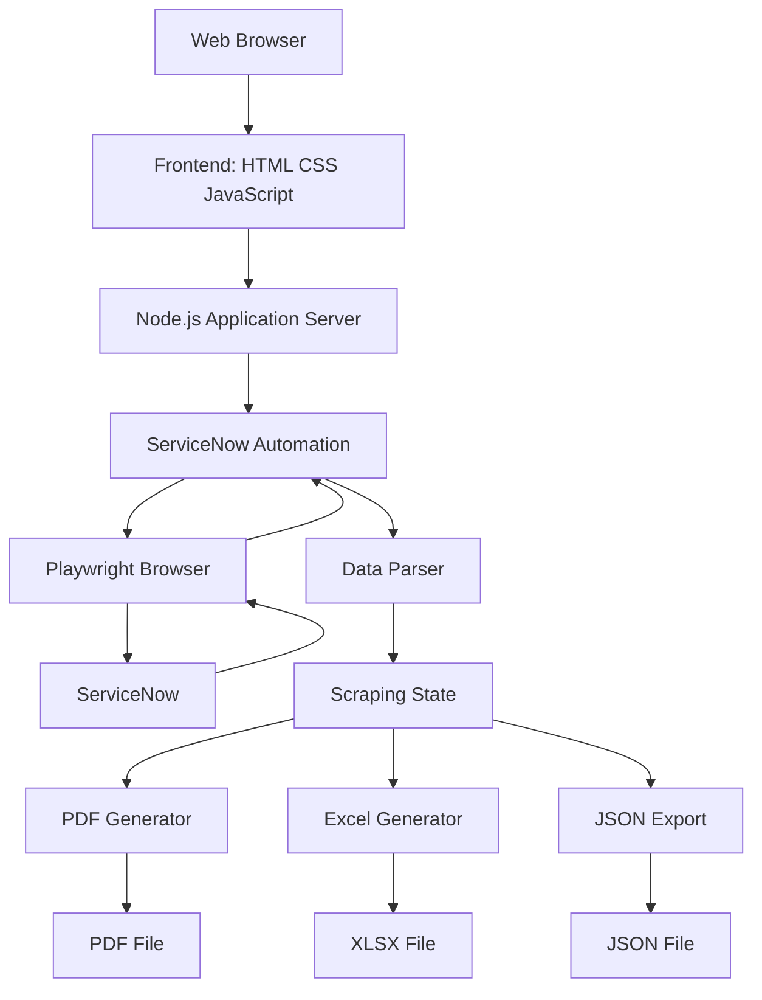
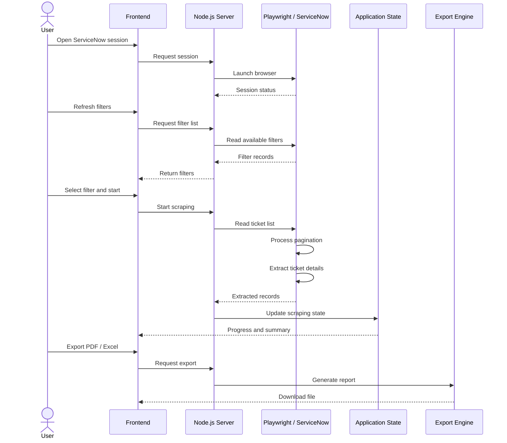
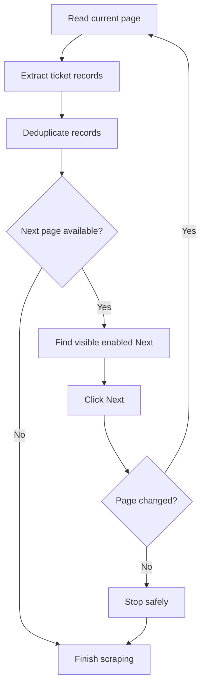

# ScrapeChangeTicket

<p align="center">
  <strong>ServiceNow Automation · Data Extraction · Reporting</strong>
</p>

<p align="center">
  Node.js · Playwright · JavaScript ES Modules · PDF · Excel · JSON
</p>

<p align="center">
  <a href="#-overview">Overview</a> ·
  <a href="#-architecture">Architecture</a> ·
  <a href="#-installation">Installation</a> ·
  <a href="#-usage">Usage</a> ·
  <a href="#-api-reference">API Reference</a> ·
  <a href="#-testing">Testing</a>
</p>

---

## Table of Contents

1. [Overview](#-overview)
2. [Core Features](#-core-features)
3. [System Architecture](#-architecture)
4. [Technology Stack](#-technology-stack)
5. [Prerequisites](#-prerequisites)
6. [Installation](#-installation)
7. [Environment Configuration](#-environment-configuration)
8. [Running the Application](#-running-the-application)
9. [Application Workflow](#-application-workflow)
10. [Scraping Engine](#-scraping-engine)
11. [Data Structure](#-data-structure)
12. [Export Engine](#-export-engine)
13. [API Reference](#-api-reference)
14. [Project Structure](#-project-structure)
15. [Testing and Quality Assurance](#-testing)
16. [Debugging and Troubleshooting](#-debugging)
17. [Security](#-security)
18. [Developer Workflow](#-developer-workflow)

---

## 1. Overview

ScrapeChangeTicket is a web-based automation application designed to extract, process, organize, and export Change Task records from ServiceNow.

The application combines browser automation, structured data extraction, and automated document generation in a single workflow.

### Primary objectives

- Automate ServiceNow ticket collection.
- Retrieve records using existing ServiceNow filters.
- Process multiple result pages through pagination.
- Extract ticket details and activity records.
- Normalize extracted information into structured JSON.
- Generate standardized PDF reports.
- Generate Excel workbooks for further analysis.

### Processing overview

| Input | Processing | Output |
|---|---|---|
| ServiceNow session | Browser automation | Authenticated session |
| Saved filter | Filter discovery | Filter selection |
| Ticket list | Pagination and extraction | Ticket records |
| Ticket detail | Field parsing | Structured data |
| Activities | Activity extraction | Activity records |
| Scraping dataset | PDF generator | PDF report |
| Scraping dataset | Excel generator | XLSX workbook |
| Scraping dataset | JSON serialization | JSON file |

---

## 2. Core Features

### 2.1 ServiceNow Integration

- Browser session management.
- Automated login detection.
- Navigation to Change Task.
- Dynamic filter discovery.
- Filter selection.
- Result estimation.
- Session status monitoring.

### 2.2 Scraping Engine

- Table extraction.
- Multi-page pagination.
- Ticket detail extraction.
- Activity extraction.
- Duplicate prevention.
- Configurable ticket limit.
- Progress monitoring.
- Per-ticket error tracking.

### 2.3 Data Management

- Centralized scraping result.
- Structured ticket records.
- Display-value normalization.
- Scraping history.
- JSON export.
- Success and failure statistics.

### 2.4 Reporting Engine

**PDF**
- Standardized report layout.
- A4 portrait format.
- Structured table rendering.
- Result classification.
- Long-content pagination.
- Continuation-page support.
- Dynamic page numbering.

**Excel**
- Structured ticket columns.
- Formatted headers.
- Freeze panes.
- Autofilter.
- Metadata worksheet.

**JSON**
- Complete scraping metadata.
- Ticket records.
- Detail information.
- Activity records.
- Error information.

---

## 3. System Architecture

### High-level architecture



### Processing sequence



### Architectural responsibilities

| Component | Responsibility |
|---|---|
| Frontend | User interface and interaction |
| Server | HTTP routing and application orchestration |
| ServiceNow module | Browser automation and extraction |
| Parser | Data normalization |
| PDF module | PDF document generation |
| Excel module | Spreadsheet generation |
| Tests | Functional and regression validation |

---

## 4. Technology Stack

| Layer | Technology |
|---|---|
| Runtime | Node.js |
| Package manager | npm |
| Backend | Node.js |
| Frontend | HTML5, CSS3, JavaScript ES Modules |
| Automation | Playwright |
| PDF | Existing PDF generator in `src/pdf.js` |
| Spreadsheet | ExcelJS |
| Testing | Node.js Test Runner |
| E2E Testing | Playwright Test |
| Code quality | ESLint |
| Data format | JSON |

---

## 5. Prerequisites

Required software:

- Windows 10/11.
- Node.js and npm.
- Chromium browser installed through Playwright.
- ServiceNow account with authorized access.
- Network connectivity to the ServiceNow instance.

### Verify installed tools

Open PowerShell:

```powershell
node --version
npm --version
git --version
```

Check project dependencies:

```powershell
npm list --depth=0
```

---

## 6. Installation

### Step 1 — Clone repository

```powershell
git clone <REPOSITORY_URL>
```

Navigate to project directory:

```powershell
cd ScrapeChangeTicket
```

For an existing local project:

```powershell
cd "C:\Users\admin\Documents\1. GITHUB\ScrapeChangeTicket"
```

### Step 2 — Install dependencies

```powershell
npm install
```

This installs dependencies defined in `package.json` and updates `node_modules`.

### Step 3 — Install Playwright browser

```powershell
npx playwright install chromium
```

### Step 4 — Verify installation

```powershell
node --version
npm --version
npx playwright --version
```

### Step 5 — Inspect available npm scripts

```powershell
npm run
```

This displays scripts registered in `package.json`.

---

## 7. Environment Configuration

The application uses environment configuration for credentials and runtime settings.

### Create environment file

If `.env.example` exists:

```powershell
Copy-Item .env.example .env
```

Open the configuration:

```powershell
notepad .env
```

Configure the variables according to the names consumed by the application source code.

Do not assume variable names. Inspect `src/server.js` and `src/servicenow.js` when setting up a new environment.

### Security requirements

- Do not hardcode credentials.
- Do not commit `.env`.
- Do not expose session cookies or authentication tokens.
- Keep `.env.example` free of real credentials.
- Restrict access to generated operational reports.

Verify `.gitignore`:

```powershell
Get-Content .gitignore
```

At minimum, sensitive local files should be excluded:

```gitignore
.env
.env.*
!.env.example
node_modules/
```

Adjust exclusions to preserve any intentionally tracked configuration files.

---

## 8. Running the Application

### Start server

```powershell
npm start
```

Expected local URL:

```text
http://localhost:3000
```

Open the URL in a browser.

### Check server availability

In another PowerShell window:

```powershell
Test-NetConnection localhost -Port 3000
```

### Inspect port usage

```powershell
netstat -ano | findstr :3000
```

### Stop the application

Press:

```text
CTRL + C
```

### Restart

```powershell
npm start
```

---

## 9. Application Workflow

### 9.1 Session Initialization

1. Open the application.
2. Start the ServiceNow browser session.
3. Complete authentication if required.
4. Wait for session detection.
5. Confirm browser connection status.

### 9.2 Filter Discovery

The application reads filters from the ServiceNow list interface.

Expected process:

1. Navigate to Change Task.
2. Identify the active list frame.
3. Open List controls.
4. Open Filters.
5. Read available filter entries.
6. Exclude non-filter actions and placeholders.
7. Return valid filter names to the frontend.

### 9.3 Estimate Records

Select a filter and request an estimated record count.

The estimate should be taken from the active ServiceNow list, not fabricated from local data.

### 9.4 Execute Scraping

Set the ticket limit:

| Value | Behavior |
|---|---|
| 0 | Process all available records |
| Positive integer | Process up to the specified limit |

Start scraping and monitor progress.

### 9.5 Validate Results

Before exporting, verify:

- Selected filter.
- Total records found.
- Number processed.
- Successful records.
- Failed records.
- Duplicate handling.
- Scraping completion status.

### 9.6 Export

The export engine uses the active scraping dataset.

No manual ticket-by-ticket selection is required.

Available output formats:

- PDF
- XLSX
- JSON

---

## 10. Scraping Engine

### 10.1 Frame Selection

ServiceNow may render list content inside an iframe.

The automation must select the active frame containing the actual ticket list and pagination controls.

The implementation uses the relevant frame, such as `gsft_main`, while validating that the frame contains the expected list elements.

### 10.2 Table Extraction

The extraction process should:

1. Identify visible ticket tables.
2. Select the table containing the relevant ticket links.
3. Read actual record rows.
4. Map column headers to values.
5. Ignore interface-only and generated noise fields.

### 10.3 Pagination

Pagination must be processed sequentially.

Recommended control flow:



Pagination safeguards:

- Select controls from the correct frame.
- Prefer visible and enabled controls.
- Ignore hidden duplicate controls.
- Verify that the page actually changes.
- Track page signatures.
- Track processed ticket identifiers.
- Enforce maximum page limits.
- Stop if pagination becomes stuck.
- Prevent infinite loops.
- Do not silently skip pages.

A pagination failure must be reported as an error rather than treated as successful completion.

### 10.4 Duplicate Prevention

Ticket identifiers are used to identify previously processed records.

A ticket already present in the processed set must not be added again.

### 10.5 Error Handling

Errors should be recorded at the appropriate level:

- Session initialization error.
- Filter discovery error.
- Table extraction error.
- Pagination error.
- Ticket detail error.
- Activity extraction error.
- Export generation error.

A failure on an individual ticket should not silently corrupt the entire dataset.

---

## 11. Data Structure

The application stores scraping results as structured JSON.

### Example metadata

```json
{
  "metadata": {
    "source": "ServiceNow",
    "filter_name": "CTASK SEPTEMBER",
    "scraped_at": "2026-11-01T00:00:00.000Z",
    "total_found": 272,
    "processed": 10,
    "success": 10,
    "failed": 0
  },
  "tickets": []
}
```

This is an illustrative structure. Actual metadata must reflect the real scraping execution.

### Ticket data domains

| Object | Description |
|---|---|
| `metadata` | Scraping context and counters |
| `tickets` | Collection of extracted tickets |
| `data_tabel` | Original list-table information |
| `detail_tiket` | Ticket detail fields |
| `activities` | Activity history |
| `scrape_status` | Per-ticket processing result |
| `errors` | Extraction errors |
| `report` | Reporting classification |

### Data normalization

The parser should distinguish:

- Display values.
- Internal ServiceNow identifiers.
- HTML content.
- Plain text.
- Empty values.
- Missing values.

Internal identifiers such as sys_id should not be presented as human-readable names when a display value is available.

---

## 12. Export Engine

### 12.1 PDF Generator

Source module:

```text
src/pdf.js
```

Responsibilities:

- Generate standardized PDF reports.
- Render structured ticket information.
- Preserve table borders and column widths.
- Handle long descriptions.
- Handle long Cause and Action Plan content.
- Create continuation pages.
- Maintain page numbering.

### Long-content handling

A ticket that exceeds one page should continue on subsequent pages.

The generator must preserve:

- Ticket identity.
- Field ordering.
- Table structure.
- Text readability.
- Continuation indicators.
- Page numbering.

The export must not silently truncate important information.

### 12.2 Excel Generator

Source module:

```text
src/excel.js
```

Responsibilities:

- Generate XLSX workbooks.
- Create structured data columns.
- Format header rows.
- Apply freeze panes.
- Enable autofilter.
- Create metadata worksheet.
- Preserve display values.

### 12.3 JSON Export

JSON export should preserve the complete scraping dataset, including metadata and ticket processing status.

### 12.4 Export validation

Before accepting an export as valid:

- Check the generated file exists.
- Check file size is non-zero.
- Check expected ticket identifiers are present.
- Check PDF page dimensions.
- Check long-content continuation.
- Check Excel worksheet names.
- Check row and column counts.
- Check metadata consistency.

---

## 13. API Reference

The application exposes HTTP endpoints through its Node.js server.

The following are the documented functional areas. Confirm exact HTTP methods, paths, and request schemas against the current route definitions in `src/server.js` before integrating external clients.

| API area | Function |
|---|---|
| Session | Open and inspect browser session |
| Filters | Refresh and retrieve available filters |
| Estimate | Estimate records for a selected filter |
| Scraping | Start, pause, resume, or cancel processing |
| Progress | Retrieve scraping state |
| History | Retrieve previous scraping runs |
| Tickets | Retrieve extracted ticket records |
| PDF | Preview and generate PDF reports |
| Excel | Generate XLSX reports |
| JSON | Download complete scraping data |

### Local API inspection

Check the server source:

```powershell
Get-Content .\src\server.js
```

Search route definitions:

```powershell
Select-String -Path .\src\server.js -Pattern "app.get|app.post|router.get|router.post"
```

Check the local server:

```powershell
Invoke-WebRequest http://localhost:3000
```

For JSON endpoints:

```powershell
Invoke-RestMethod http://localhost:3000/api/filters/refresh
```

Use the actual endpoint and HTTP method defined in the current application. Some endpoints may require an active session or request body.

---

## 14. Project Structure

```text
ScrapeChangeTicket/
│
├── src/
│   ├── server.js
│   ├── servicenow.js
│   ├── parsers.js
│   ├── pdf.js
│   └── excel.js
│
├── public/
│   ├── index.html
│   ├── styles.css
│   ├── app.js
│   └── assets/
│
├── tests/
│   ├── unit/
│   ├── integration/
│   └── e2e/
│
├── reference/
│
├── output/
│
├── .env
├── .env.example
├── .gitignore
├── package.json
├── package-lock.json
└── README.md
```

The structure is a logical overview. Verify actual file and directory names in the current repository.

### Module responsibilities

| File | Responsibility |
|---|---|
| `src/server.js` | HTTP server and application routes |
| `src/servicenow.js` | ServiceNow browser automation |
| `src/parsers.js` | Data parsing and normalization |
| `src/pdf.js` | PDF generation |
| `src/excel.js` | Excel generation |
| `public/index.html` | Frontend structure |
| `public/styles.css` | Frontend styling |
| `public/app.js` | Frontend application logic |

---

## 15. Testing

### Run all Node tests

```powershell
npm test
```

### Run lint

```powershell
npm run lint
```

### Run Playwright E2E

```powershell
npm run test:e2e
```

If the project uses the Playwright CLI directly:

```powershell
npx playwright test
```

### Run E2E with visible browser

```powershell
npx playwright test --headed
```

### Run a specific test file

```powershell
node --test tests/integration/filters-menu.test.js
```

```powershell
node --test tests/integration/export.test.js
```

### Run unit and integration tests

```powershell
node --test tests/unit/*.test.js tests/integration/*.test.js
```

### Test coverage areas

| Area | Validation |
|---|---|
| Filter discovery | Menu state and filter extraction |
| Pagination | Page transitions and stopping conditions |
| Deduplication | Duplicate ticket prevention |
| Parsing | Field normalization |
| PDF | Layout and continuation pages |
| Excel | Worksheet and cell validation |
| API | Response status and validation |
| Frontend | Button state and progress |
| E2E | User workflow |

### Previous reported checkpoint

| Test | Reported result |
|---|---:|
| Node tests | 24 passed |
| ESLint | Passed |
| Playwright E2E | 2 passed |
| PDF sample | Valid |
| Excel sample | Valid |

These are historical checkpoint results, not a guarantee of the current working tree. Re-run tests after modifications.

---

## 16. Debugging and Troubleshooting

### Inspect server logs

Run the server in a visible PowerShell terminal:

```powershell
npm start
```

Observe the log output during browser initialization and scraping.

### Inspect port 3000

```powershell
netstat -ano | findstr :3000
```

### Identify process

```powershell
Get-NetTCPConnection -LocalPort 3000 -State Listen
```

### Stop a process by PID

Only after verifying the PID belongs to this application:

```powershell
Stop-Process -Id <PID> -Force
```

### Common problems

| Problem | Possible cause |
|---|---|
| Login not detected | SSO or session not ready |
| Filters unavailable | List controls or submenu not opened |
| Zero tickets | Incorrect table or filter context |
| Pagination timeout | Hidden or incorrect Next control |
| Duplicate records | Incorrect record identity handling |
| Empty activities | Activity selector or frame mismatch |
| PDF generation error | Invalid or oversized report content |
| Excel export failure | Invalid dataset or workbook generation |

### Debugging principles

1. Reproduce the error.
2. Capture the exact error message.
3. Identify the responsible module.
4. Inspect the active browser frame.
5. Validate selectors against the live DOM.
6. Add a focused regression test.
7. Re-run relevant tests.
8. Verify the real application workflow when possible.

Do not use `force: true` as the default solution for Playwright interaction problems.

---

## 17. Security

The application may handle internal operational data and authenticated browser sessions.

Security requirements:

- Keep credentials outside source code.
- Exclude `.env` from version control.
- Do not expose session cookies.
- Restrict generated report access.
- Avoid committing real scraping datasets.
- Avoid publishing screenshots containing confidential information.
- Validate user input on server endpoints.
- Apply access controls appropriate to the deployment environment.

---

## 18. Developer Workflow

### Inspect repository state

```powershell
git status
```

### Review modified files

```powershell
git diff
```

### Check npm scripts

```powershell
npm run
```

### Run quality checks

```powershell
npm test
npm run lint
npm run test:e2e
```

### Stage changes

```powershell
git add src public tests README.md
```

### Commit changes

```powershell
git commit -m "feat: improve scraping and reporting"
```

### Review commit history

```powershell
git log --oneline -10
```

### Push changes

```powershell
git push
```

Before committing, inspect staged changes and ensure `.env`, private data, generated reports, and local browser artifacts are excluded.

---

## 19. Operational Checklist

### Before scraping

- [ ] Application server is running.
- [ ] ServiceNow session is authenticated.
- [ ] Filter list has been refreshed.
- [ ] Correct filter is selected.
- [ ] Estimated record count is available.
- [ ] Ticket limit is configured.

### After scraping

- [ ] Scraping process has completed.
- [ ] Processed count is checked.
- [ ] Failed records are reviewed.
- [ ] Duplicate records are checked.
- [ ] Ticket details are reviewed.
- [ ] Activities are checked where applicable.

### Before exporting

- [ ] Correct scraping dataset is active.
- [ ] Ticket count is verified.
- [ ] PDF preview is checked.
- [ ] Long-content pages are checked.
- [ ] Excel data and metadata are checked.
- [ ] Exported files are stored securely.

---

## 20. Future Development

Potential improvements:

- More robust session recovery.
- Configurable scraping concurrency.
- Improved retry strategy.
- Detailed extraction diagnostics.
- Export audit logs.
- Advanced ticket search.
- Additional report formats.
- Automated regression tests.
- Deployment configuration.
- Performance monitoring.

---

## Project Information

| Property | Value |
|---|---|
| Project | ScrapeChangeTicket |
| Category | Automation & Reporting |
| Runtime | Node.js |
| Automation | Playwright |
| Frontend | Vanilla JavaScript |
| Export formats | PDF, XLSX, JSON |
| Deployment | Local application |

<p align="center">
  <strong>ScrapeChangeTicket</strong><br/>
  <sub>Automated ServiceNow Ticket Extraction & Reporting</sub>
</p>